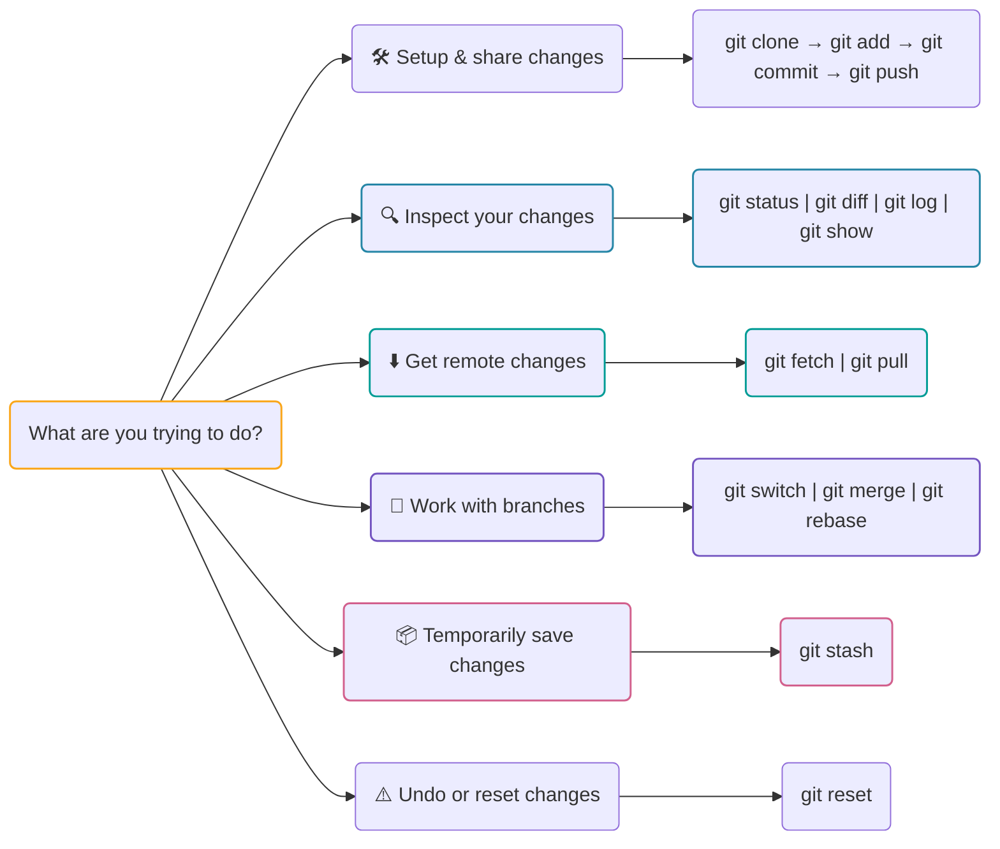
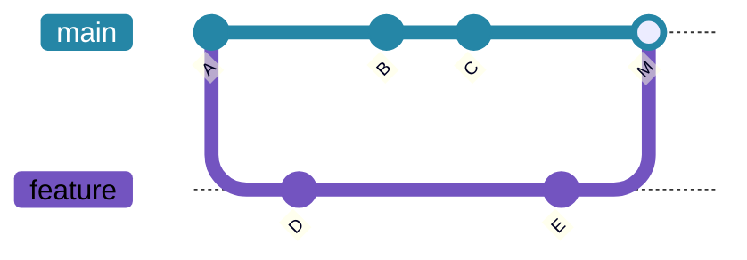
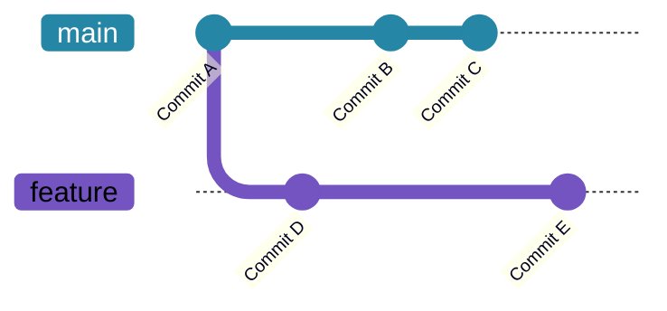
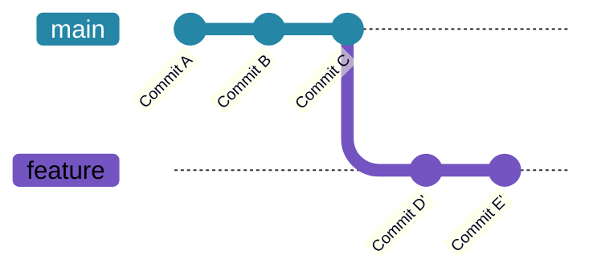

# Essential Git Commands

## Introduction

Not sure which Git command to use next? This guide is a quick reference for everyday Git workflows, including contributions to ACCESS-NRI repositories.

Designed for users with some familiarity with Git, it helps you find **which commands to use, when and how**, whether you need to:

- Inspect commits and changes
- Work with branches
- Fetch and integrate remote changes
- Temporarily save unfinished work
- Manage or undo changes to Git history

!!! note
    The examples below use generic branch names such as `main` and `feature`. Replace these with the branch names used in your repository.

!!! info
    Square brackets in command syntax, such as `[<remote>]`, indicate optional arguments; don't type the brackets.

## Find the right Git command
Use the diagram below to find commonly used Git commands by task. 



## Core Git commands at a glance

Here are a few core Git commands that are useful to keep handy in everyday Git workflows. For more details, please refer to the link in the command.

| Command | Example Usage | Purpose |
|---|---|---|
| [`git clone`](https://git-scm.com/docs/git-clone) | `git clone <url> <local_dir>` | Copy a remote repository to your local machine|
| [`git add`](https://git-scm.com/docs/git-add) | `git add <file>` | Stage changes for commit. |
| [`git commit`](https://git-scm.com/docs/git-commit) | `git commit -m "<message>"` | Save staged changes as a new commit. |
| [`git push`](https://git-scm.com/docs/git-push)| `git push` | Push local commits to the remote repository. |
| [`git status`](https://git-scm.com/docs/git-status) | `git status` | Show status of current working tree. |
| [`git diff`](https://git-scm.com/docs/git-diff) | `git diff origin/<branch>` | Visualise source code differences |
| [`git log`](https://git-scm.com/docs/git-log) | `git log [-c]` | Show the history of the repository |s
| [`git show`](https://git-scm.com/docs/git-show) | `git show <commit>` | Look into a specific Git commit |
| [`git fetch`](https://git-scm.com/docs/git-fetch) | `git fetch [<remote>]` | Update remote tracking branches |
| [`git pull`](https://git-scm.com/docs/git-pull) | `git pull` | updates the local branch to match the remote |
| [`git branch`](https://git-scm.com/docs/git-branch)|  `git branch -a` | List all branches |
| [`git switch`](https://git-scm.com/docs/git-switch) | `git switch [-c] <branch>` | Switch the HEAD to a different branch |
| [`git merge`](https://git-scm.com/docs/git-merge) | `git merge <feature-branch>` | Combines the histories of two branches |
| [`git rebase`](https://git-scm.com/docs/git-rebase) | `git rebase <branch>` | Moves your branch commits on top of another branch |
| [`git stash`](https://git-scm.com/docs/git-stash) | `git stash [push\|pop\|apply]` | Temporarily save changes into stash space |
| [`git reset`](https://git-scm.com/docs/git-reset) | `git reset --hard origin/<branch>` | Reset branch to match another branch state |

### Git fetch

The `git fetch` command updates your remote tracking branches.

#### When to use {: .no-toc }

At the beginning of your work and before switching branches.

Use `git fetch` to:

- To update remote tracking branches when your workspace has uncommitted changes that you don't want to disturb or `stash`.

- To update remote tracking branches when your local repository clone has become stale.


#### How to use {: .no-toc }

To fetch updates from the remote repository, simply run
```
git fetch
```
This assumes that you have only one *remote*. It is also a good practice to keep branches *pruned*. Use
```
git fetch -p
```
to remove any remote-tracking references that no longer exist on the remote.
The full command uses an optional *remote* and an optional *branch*, e.g.:
```
git fetch [<remote>] [<branch>]
```

!!! tip
    Unlike `git pull`, `git fetch` does not merge or rebase changes into your current branch. This makes it useful when you want to inspect remote updates before integrating them.

### Git pull

The `git pull` command updates your remote tracking branches *and* updates the local branch in your current workspace to match the remote.

#### When to use {: .no-toc }

At the beginning of your work and before switching branches.

Use `git pull`:

- To update the local branch in your current workspace when the branch is clean and there are no uncommitted changes and no potential merge conflicts from the remote tracking branch.

- To update the local branch when you are prepared to deal with merge conflicts coming from the remote tracking branch.

#### Recommended usage

Before running `git pull`, make sure you are on the local branch that you want to update. Then run
```
git pull
```
Warning: If your local and remote branches have diverged, `git pull` by default reports an error asking you to specify how to reconcile the divergent branches.
To reapply your local commits on top of the latest remote commits, use:
```
git pull --rebase
```
instead. See `git merge` and `git rebase` here for more details. The full command also uses an optional *remote* and an optional *branch*, e.g.:
```
git pull [<remote>] [<branch>]
```

### Git switch

Git switch allows us to switch the `HEAD` to a different branch.

#### When to use {: .no-toc }

- To create a new branch.
- To switch to an existing branch, either local or remote.


#### How to use {: .no-toc }

##### Create a new branch {: .no-toc }

To create a new branch that doesn't exist locally or on the remote repository:
```
git switch -c <new_branch_name> [<source_branch>]
```

This creates the new branch and switches to it.

##### Switch to an existing branch {: .no-toc }

To switch to a branch that already exists locally, simply use:
```
git switch <existing_branch>
```

If this branch only exist on the remote directory but not locally, please use:
```
git switch --track origin/<existing_branch>
```

### Git merge
`git merge` combines the histories of two branches. If the branches have diverged, Git will usually create a merge commit that keeps the history of both branches.



#### When to use {: .no-toc }

- To combine completed work from another branch.
- When preserving the existing branch history is useful.
- When working on a shared branch where rewriting existing commits should be avoided.

#### How to use {: .no-toc }

First, switch to the branch that should receive the changes:

```
git switch <target-branch>
```

Then merge the other branch:

```
git merge <branch-to-merge>
```

For example:

```
git switch main
git merge feature-branch
```

If Git cannot combine the changes automatically, it will report a merge conflict. Resolve the conflicting files, stage them, and complete the merge:

```
git add <resolved-file>
git commit
```

### Git rebase

`git rebase` moves your branch commits so they are replayed on top of another branch. This can create a cleaner, more linear history.

A common workflow is to update a feature branch with the latest changes from `main`:

```
git switch feature-branch
git fetch origin
git rebase origin/main
```

Conceptually, this changes a history like:


Before rebase:



After rebase:



#### When to use {: .no-toc }

- To update a feature branch with recent changes from another branch.
- To keep feature branch history relatively linear.
- To tidy local work before it is merged.

#### Resolving rebase conflicts

If Git finds a conflict during the rebase, resolve the affected files and stage them:

```
git add <resolved-file>
```

Then continue:

```
git rebase --continue
```

To cancel the rebase and return to the state before it started:

```
git rebase --abort
```

??? warning "Rebasing: things to keep in mind"

    - **Avoid rebasing shared branches.** Rebase rewrites commit history, which can cause problems for others working from the same commits.

    - **Rebase your own feature branches when appropriate.** It can help incorporate upstream changes and maintain a linear commit history.
    
    - **Be careful when pushing rebased commits.** If your feature branch has already been pushed, you may need to update the remote branch using `git push --force-with-lease`. This checks whether the remote branch has changed unexpectedly before updating it, reducing the risk of overwriting someone else's work.

### Git stash

Git stash works as a temporary save button. It lets us save changes that we are not ready to commit, so we can temporarily switch to other work without committing unfinished changes to the Git history.

#### When to use {: .no-toc }

- If working on one branch and needing to switch to another branch.
- To pull updates from the remote repository, when local changes are not ready to commit.
- If working on the wrong branch, to move those changes to the correct branch.

#### How to use {: .no-toc }

#### 1. Save changes

To save our current changes in the stash, with a message to help us remember what they are:
```
git stash push -m "Message for myself Nov 13th"
```
Think of this as putting our changes into a virtual drawer and leaving a sticky note on it. 
By default, `git stash` saves changes to tracked files that are modified or deleted. 
Untracked files are not included unless we explicitly ask Git to include them.

#### 2. List stashes

To see all the stashes you have created:
```
git stash list
```
We may see something like:
```
stash@{0}: On main: WIP: Message for myself Nov 13th
stash@{1}: On dev: update documentation
```

To check the content of one specific stash, for example, `{0}`:
```
git stash show -p stash@{0}
```

#### 3. Apply a stash

To bring the changes from the most recent stash onto our current branch:
```
git stash pop
```
or
```
git stash apply
```
The latter command leaves a copy in the stash.


#### 4. Clean up stash

To delete a specific stash:
```
git stash drop stash@{0}
```
Or to clean up all stashes:
```
git stash clear
```


### Git reset

#### When to use {: .no-toc }

Use `git reset` when the state of the branch needs to be changed to the state of another branch. e.g., synchronising two branches. 
This command is to be used carefully because it may delete the state of the current branch by changing its history and discarding uncommitted changes. 

#### How to use {: .no-toc }
```
git reset --hard origin/<branch>
```
is a useful command to reset the local branch to match the remote branch.


### Git log

#### When to use {: .no-toc }

Use `git log` to see the history of the repository.

#### How to use {: .no-toc }

The basic command is 
```
git log
```
and you may add some optional flags such as `[<--oneline>]` to display each commit on a single line,
`[<--graph>]` to display the commit history as a graph.
An example of `git log --graph --online` is shown below:

<div markdown="0">
<terminal-window lineDelay="200">
    <terminal-line data="input">git log --graph --oneline</terminal-line>
    <terminal-line>* <span class="nri-orange-color">a8f3c21</span> (<span class="git-cyan">HEAD</span> -&gt; <span class="git-green">main</span>) Add documentation</terminal-line>
    <terminal-line>*   <span class="nri-orange-color">b7e2d14</span> Merge branch 'feature-login'</terminal-line>
    <terminal-line><span class="git-red">|</span><span class="git-green">\</span></terminal-line>
    <terminal-line><span class="git-red">|</span> * <span class="nri-orange-color">c9d4a62</span> (<span class="git-green">feature-login</span>) Add unit tests</terminal-line>
    <terminal-line><span class="git-red">|</span> * <span class="nri-orange-color">e5f6b31</span> Add feature</terminal-line>
    <terminal-line>* <span class="git-green">|</span> <span class="nri-orange-color">d4a2f81</span> Update README</terminal-line>
    <terminal-line><span class="git-red">|</span><span class="git-green">/</span></terminal-line>
    <terminal-line>* <span class="nri-orange-color">f1b2c34</span> Initial project setup</terminal-line>
</terminal-window>
</div>

### Git show

The `git show` command lets you look into specific Git objects, usually one commit.

#### When to use {: .no-toc }

- You already know the commit you care about and want to see its message, metadata and diff in one shot.
- You want to see what a specific file looked like at a specific past commit.
- You want to double-check a tag's message and what commit it points to.

#### How to use {: .no-toc }
```
git show <commit>
```

Running only `git show` will display details about the most recent commit.

`<commit>` can be any Git reference (e.g., commit hash, branch name, tag, references like `HEAD~2`, etc.).

You can also specify a single file after the Git reference, to see that file's version at that point in time:
```
git show <commit>:<file-path>
```

### Git diff

#### When to use {: .no-toc }

Run `git diff` to visualise the source code differences. 

#### How to use {: .no-toc }

A useful command to see the difference between the local branch and the remote branch:
```
git diff origin/<branch>
```
A good step before pushing the local branch to the remote branch.

To display the difference in a graphical diff program, run `git difftool -y --tool=<program>`. 
For example, if you want to use the program `meld`, then run:
```
git difftool -y --tool=meld
```
