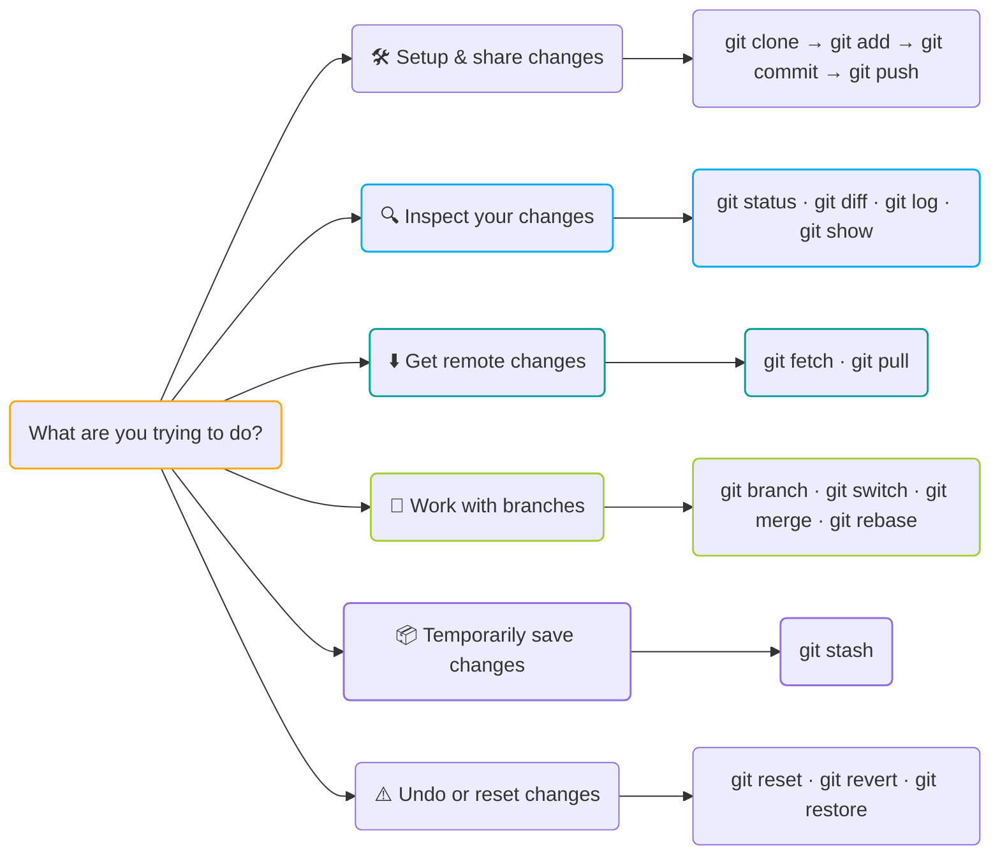
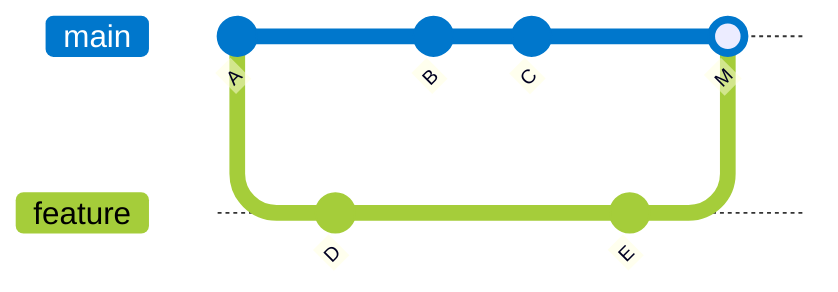
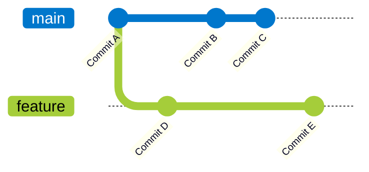
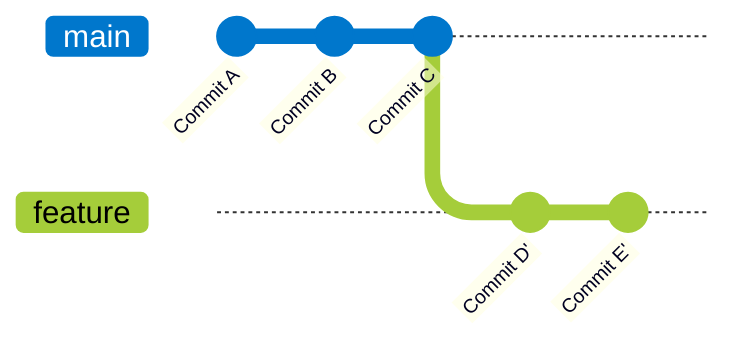

# Essential Git Commands

## Introduction

Not sure which Git command to use next? This guide is a quick reference for everyday Git workflows, including contributions to ACCESS-NRI repositories.

Designed for users with some familiarity with Git, it helps you find **which commands to use, when and how**, whether you need to:

- Inspect commits and changes
- Work with branches
- Fetch and integrate remote changes
- Temporarily save unfinished work
- Manage or undo changes to Git history

!!! note
    Run commands from inside your local repository unless you are cloning it. The examples below use generic branch names such as `main` and `feature`. Replace these with the branch names used in your repository.

!!! info
    Square brackets, such as `[<remote>]` indicate optional arguments. Angle brackets, such as `<branch>` indicate placeholders to replace with your own values. Do not type the brackets.

## Find the right Git command
Use the diagram below to find commonly used Git commands by task. 



## Core Git commands at a glance

These are a few core Git commands that are useful to keep handy in everyday Git workflows. Select a command to open its official Git documentation.

| Command | Example usage | Purpose |
|---|---|---|
| [`git add`](#git-add) [📖](https://git-scm.com/docs/git-add "Official Git manual: git add") | `git add <file>` | Stage changes for the next commit. |
| [`git branch`](#git-branch) [📖](https://git-scm.com/docs/git-branch "Official Git manual: git branch") | `git branch -a` | List local and remote-tracking branches. |
| [`git clone`](#git-clone) [📖](https://git-scm.com/docs/git-clone "Official Git manual: git clone") | `git clone <url>` | Create a local copy of a repository. |
| [`git commit`](#git-commit) [📖](https://git-scm.com/docs/git-commit "Official Git manual: git commit") | `git commit -m "<message>"` | Record staged changes. |
| [`git diff`](#git-diff) [📖](https://git-scm.com/docs/git-diff "Official Git manual: git diff") | `git diff` | Inspect unstaged changes. |
| [`git fetch`](#git-fetch) [📖](https://git-scm.com/docs/git-fetch "Official Git manual: git fetch") | `git fetch` | Download remote updates without integrating them. |
| [`git log`](#git-log) [📖](https://git-scm.com/docs/git-log "Official Git manual: git log") | `git log --oneline` | View commit history. |
| [`git merge`](#git-merge) [📖](https://git-scm.com/docs/git-merge "Official Git manual: git merge") | `git merge <branch>` | Integrate changes from another branch. |
| [`git pull`](#git-pull) [📖](https://git-scm.com/docs/git-pull "Official Git manual: git pull") | `git pull` | Fetch and integrate remote changes. |
| [`git push`](#git-push) [📖](https://git-scm.com/docs/git-push "Official Git manual: git push") | `git push` | Share local commits with a remote repository. |
| [`git rebase`](#git-rebase) [📖](https://git-scm.com/docs/git-rebase "Official Git manual: git rebase") | `git rebase <branch>` | Replay commits on a new base. |
| [`git reset`](#git-reset) [📖](https://git-scm.com/docs/git-reset "Official Git manual: git reset") | `git reset -- <file>` | Unstage a file without changing its contents. |
| [`git restore`](#git-restore) [📖](https://git-scm.com/docs/git-restore "Official Git manual: git restore") | `git restore --staged <file>` | Unstage a file or restore its contents. |
| [`git revert`](#git-revert) [📖](https://git-scm.com/docs/git-revert "Official Git manual: git revert") | `git revert <commit>` | Undo a commit by creating a new commit. |
| [`git show`](#git-show) [📖](https://git-scm.com/docs/git-show "Official Git manual: git show") | `git show <commit>` | Inspect a specific commit. |
| [`git stash`](#git-stash) [📖](https://git-scm.com/docs/git-stash "Official Git manual: git stash") | `git stash push` | Temporarily save unfinished changes. |
| [`git status`](#git-status) [📖](https://git-scm.com/docs/git-status "Official Git manual: git status") | `git status` | Check the current branch and working tree. |
| [`git switch`](#git-switch) [📖](https://git-scm.com/docs/git-switch "Official Git manual: git switch") | `git switch <branch>` | Switch to another branch. |

## Setup & share changes

### Git clone

The `git clone` command creates a local copy of an existing repository, including its commit history.

#### When to use {: .no-toc }

- To start working on an existing repository.
- To create a local copy of a remote repository for development or contribution.

#### How to use {: .no-toc }

To clone a repository, run:

```bash
git clone <url>
```

By default, Git creates a directory with the same name as the repository. To specify a different local directory, use:

```bash
git clone <url> <local_dir>
```

For example:

```bash
git clone https://github.com/ACCESS-NRI/ACCESS-Hive-Docs.git
```

### Git add

The `git add` command stages changes to be included in the next commit.

#### When to use {: .no-toc }

- To prepare new or modified files for a commit.
- To selectively include changes in the next commit.
- To stage files after resolving merge or rebase conflicts.

#### How to use {: .no-toc }

To stage changes to a specific file:

```bash
git add <file>
```

To stage all changes in the repository:

```bash
git add -A
```

To interactively select which changes to stage:

```bash
git add -p
```

!!! tip

    Use `git status` to check which changes have been staged, or `git diff --staged` to review the changes before committing.

### Git commit

The `git commit` command records staged changes in the local repository's history.

#### When to use {: .no-toc }

- To record a meaningful set of changes.
- To save staged changes before sharing them with others.

#### How to use {: .no-toc }

Once the relevant changes have been staged using `git add`, run:

```bash
git commit -m "<message>"
```

For example:

```bash
git commit -m "Update installation instructions"
```

To modify the most recent commit, use:

```bash
git commit --amend
```

!!! warning

    Amending a commit rewrites its history. Avoid amending commits that other people are already working from.

### Git push

The `git push` command uploads local commits to a remote repository.

#### When to use {: .no-toc }

- To share local commits with others.
- To publish a newly created branch to a remote repository.
- To update an existing pull request with additional commits.

#### How to use {: .no-toc }

If the current branch already has an upstream branch configured, simply run:

```bash
git push
```

To push a branch to a specific remote repository:

```bash
git push <remote> <branch>
```

When pushing a newly created branch for the first time, use:

```bash
git push -u origin <branch>
```

The `-u` (or `--set-upstream`) option establishes a tracking relationship with the remote branch, allowing subsequent pushes and pulls without explicitly specifying the remote and branch.

## Inspect your changes

### Git status
The `git status` command shows the current branch, staged changes, unstaged changes and untracked files.

#### When to use {: .no-toc }
- Before committing, pulling or switching branches.
- To check which files have changed or are ready to commit.
- To check whether a merge or rebase is in progress.

#### How to use {: .no-toc }
```
git status
```

### Git log

#### When to use {: .no-toc }

Use `git log` to see the history of the repository.

#### How to use {: .no-toc }

The basic command is 
```
git log
```
and you may add some optional flags such as `[<--oneline>]` for a compact summary and `[<--graph>]` to visualise branch history.

For example,

<div markdown="0">
<terminal-window lineDelay="200">
    <terminal-line data="input">git log --graph --oneline</terminal-line>
    <terminal-line>* <span class="nri-orange-color">a8f3c21</span> (<span class="git-cyan">HEAD</span> -&gt; <span class="git-green">main</span>) Add documentation</terminal-line>
    <terminal-line>*   <span class="nri-orange-color">b7e2d14</span> Merge branch 'feature-login'</terminal-line>
    <terminal-line><span class="git-red">|</span><span class="git-green">\</span></terminal-line>
    <terminal-line><span class="git-red">|</span> * <span class="nri-orange-color">c9d4a62</span> (<span class="git-green">feature-login</span>) Add unit tests</terminal-line>
    <terminal-line><span class="git-red">|</span> * <span class="nri-orange-color">e5f6b31</span> Add feature</terminal-line>
    <terminal-line>* <span class="git-green">|</span> <span class="nri-orange-color">d4a2f81</span> Update README</terminal-line>
    <terminal-line><span class="git-red">|</span><span class="git-green">/</span></terminal-line>
    <terminal-line>* <span class="nri-orange-color">f1b2c34</span> Initial project setup</terminal-line>
</terminal-window>
</div>

### Git show

The `git show` command lets you look into specific Git objects, usually one commit.

#### When to use {: .no-toc }

- You already know the commit you care about and want to see its message, metadata and diff in one shot.
- You want to see what a specific file looked like at a specific past commit.
- You want to double-check a tag's message and what commit it points to.

#### How to use {: .no-toc }
```
git show <commit>
```

Running `git show` without an argument displays the commit currently referenced by HEAD.

`<commit>` can be any Git reference (e.g., commit hash, branch name, tag, references like `HEAD~2`, etc.).

You can also specify a single file after the Git reference, to see that file's version at that point in time:
```
git show <commit>:<file-path>
```

### Git diff

The `git diff` commands shows differences between versions of files. 

#### When to use {: .no-toc }

- To review changes before staging or committing them.
- To compare local work with another branch.
- To understand what has changed between commits.

#### How to use {: .no-toc }

A useful command to see the difference between the local branch and the remote branch:

| Command | What it compares |
|---|---|
| `git diff` | Working tree against the staging area (unstaged changes). |
| `git diff --staged` | Staging area against HEAD (staged changes). |
| `git diff HEAD` | Working tree against HEAD (staged and unstaged tracked changes). |
| `git diff HEAD origin/<branch>` | Current commit against the last fetched state of the remote branch. |

To inspect changes introduced by your branch since it diverged from `origin/main`:

```
git fetch origin
git diff origin/main...HEAD
```

To display the difference in a graphical diff program, run `git difftool -y --tool=<program>`. 
For example, if you want to use the program `meld`, then run:
```
git difftool -y --tool=meld
```

## Get remote changes

### Git fetch

The `git fetch` command downloads commits and updates remote-tracking branches without integrating them into your current branch.

#### When to use {: .no-toc }

- At the beginning of your work or before switching branches.
- When you want to inspect remote updates before integrating them. 
- When you have uncommitted changes that you do not want to disturb.
- To update remote tracking branches when your local repository clone has become stale.

#### How to use {: .no-toc }

To fetch updates from the remote repository, simply run
```
git fetch
```
This assumes that you have only one *remote*. It is also a good practice to keep branches *pruned*. Use
```
git fetch -p
```
to remove any remote-tracking references that no longer exist on the remote.
The full command uses an optional *remote* and an optional *branch*, e.g.:
```
git fetch [<remote>] [<branch>]
```

!!! tip
    Unlike `git pull`, `git fetch` does not merge or rebase changes into your current branch. This makes it useful when you want to inspect remote updates before integrating them.

### Git pull

The `git pull` command updates your remote tracking branches *and* updates the local branch in your current workspace to match the remote.

#### When to use {: .no-toc }

At the beginning of your work and before switching branches.

Use `git pull`:

- To update the local branch in your current workspace when the branch is clean and there are no uncommitted changes and no potential merge conflicts from the remote tracking branch.

- To update the local branch when you are prepared to deal with merge conflicts coming from the remote tracking branch.

#### Recommended usage {: .no-toc }

Before running `git pull`, make sure you are on the local branch that you want to update. Then run
```
git pull
```

The full command also uses an optional *remote* and an optional *branch*, e.g.:
```
git pull [<remote>] [<branch>]
```

!!! Warning 
    If your local and remote branches have diverged, `git pull` by default reports an error asking you to specify how to reconcile the divergent branches.

To reapply your local commits on top of the latest remote commits, use:

| Command | Behaviour |
|---|---|
| `git pull --no-rebase` | Integrate remote changes using merge. |
| `git pull --rebase` | Replay local commits on top of the fetched commits. |

See `git merge` and `git rebase` here for more details. 

## Work with branches

### Git branch
The `git branch` command lists, creates or manages branches without switching to them.

#### When to use {: .no-toc }
- To see which branches are available.
- To check which branch are you currently on.
- To create or remove a local branch.

#### How to use {: .no-toc }
| Command | Purpose |
|---|---|
| `git branch` | List local branches. |
| `git branch -a` | List local and remote-tracking branches. |
| `git branch <name>` | Create a local branch without switching to it. |
| `git branch -d <name>` | Delete a local branch if Git considers it fully merged. |

Use `git switch` to move to a different branch.

### Git switch

Git switch allows us to switch the `HEAD` to a different branch.

#### When to use {: .no-toc }

- To create a new branch.
- To switch to an existing branch, either local or remote.

#### How to use {: .no-toc }

##### Create a new branch {: .no-toc }

To create a new branch that doesn't exist locally or on the remote repository:
```
git switch -c <new_branch_name> [<source_branch>]
```

This creates the new branch and switches to it.

##### Switch to an existing branch {: .no-toc }

To switch to a branch that already exists locally, simply use:
```
git switch <existing_branch>
```

If this branch only exist on the remote directory but not locally, please use:
```
git switch --track origin/<existing_branch>
```

### Git merge
`git merge` combines the histories of two branches. If the branches have diverged, Git will usually create a merge commit that keeps the history of both branches.



#### When to use {: .no-toc }

- To combine completed work from another branch.
- When preserving the existing branch history is useful.
- When working on a shared branch where rewriting existing commits should be avoided.

#### How to use {: .no-toc }

First, switch to the branch that should receive the changes:

```
git switch <target-branch>
```

Then merge the other branch:

```
git merge <branch-to-merge>
```

For example:

```
git switch main
git merge feature-branch
```

If Git cannot combine the changes automatically, it will report a merge conflict. Resolve the conflicting files, stage them, and complete the merge:

```
git add <resolved-file>
git commit
```

### Git rebase

`git rebase` moves your branch commits so they are replayed on top of another branch. This can create a cleaner, more linear history.

A common workflow is to update a feature branch with the latest changes from `main`:

```
git switch feature-branch
git fetch origin
git rebase origin/main
```

Conceptually, this changes a history like:


Before rebase:



After rebase:



#### When to use {: .no-toc }

- To update a feature branch with recent changes from another branch.
- To keep feature branch history relatively linear.
- To tidy local work before it is merged.

#### Resolving rebase conflicts {: .no-toc }

If Git finds a conflict during the rebase, resolve the affected files and stage them:

```
git add <resolved-file>
```

Then continue:

```
git rebase --continue
```

To cancel the rebase and return to the state before it started:

```
git rebase --abort
```

??? warning "Rebasing: things to keep in mind"

    - **Avoid rebasing shared branches.** Rebase rewrites commit history, which can cause problems for others working from the same commits.

    - **Rebase your own feature branches when appropriate.** It can help incorporate upstream changes and maintain a linear commit history.
    
    - **Be careful when pushing rebased commits.** If your feature branch has already been pushed, you may need to update the remote branch using `git push --force-with-lease`. This checks whether the remote branch has changed unexpectedly before updating it, reducing the risk of overwriting someone else's work.

## Temporarily save changes

### Git stash

Git stash works as a temporary save button. It lets us save changes that we are not ready to commit, so we can temporarily switch to other work without committing unfinished changes to the Git history.

#### When to use {: .no-toc }

- If working on one branch and needing to switch to another branch.
- To pull updates from the remote repository, when local changes are not ready to commit.
- If working on the wrong branch, to move those changes to the correct branch.

#### How to use {: .no-toc }

#### 1. Save changes {: .no-toc }

To save our current changes in the stash, with a message to help us remember what they are:
```
git stash push -m "Message for myself Nov 13th"
```
Think of this as putting our changes into a virtual drawer and leaving a sticky note on it. 
By default, `git stash` saves changes to tracked files that are modified or deleted. 
Untracked files are not included unless we explicitly ask Git to include them.

#### 2. List stashes {: .no-toc }

To see all the stashes you have created:
```
git stash list
```
We may see something like:
```
stash@{0}: On main: WIP: Message for myself Nov 13th
stash@{1}: On dev: update documentation
```

To check the content of one specific stash, for example, `{0}`:
```
git stash show -p stash@{0}
```
 {: .no-toc }

#### 3. Restore stashed changes {: .no-toc }

To bring the changes from the most recent stash onto our current branch:
```
git stash pop
```
or
```
git stash apply
```
The latter command leaves a copy in the stash.


#### 4. Clean up stash {: .no-toc }

To delete a specific stash:
```
git stash drop stash@{0}
```
Or to clean up all stashes:
```
git stash clear
```

## Undo or reset changes

### Git reset
The `git reset` command can unstage changes or move the current branch to another commit. Depending on the options, it can also change the staging area and working tree. 

#### When to use {: .no-toc }

- Use `git reset` when the state of the branch needs to be changed to the state of another branch. e.g., synchronising two branches. 
- To unstage a file without losing your edits. 
- To undo local commits while keeping their changes. 

!!! warning
    This command is to be used carefully because it may delete the state of the current branch by changing its history and discarding uncommitted changes. 

#### How to use {: .no-toc }

| Command | Moves current branch | Resets staging area | Resets working tree |
|---|---|---|---|
| `git reset --soft <commit>` | Yes | No | No |
| `git reset --mixed <commit>` | Yes | Yes | No |
| `git reset --hard <commit>` | Yes | Yes | Yes |

For example, to undo the latest local commit but keep its changes staged: 

```
git reset --soft HEAD~1
```

To undo the latest local commit and keep its changes unstaged: 

```
git reset --mixed HEAD~1
```
!!! danger "Discarding local changes"
    git reset --hard discards uncommitted changes to tracked files and may remove untracked files that obstruct checkout. It can also remove local commits from the current branch's history. Check git status and git log, and preserve any work you need before proceeding.

To deliberately reset a local branch to the latest fetched state of a remote branch:

```
git fetch origin
git reset --hard origin/<branch>
```

### Git restore

The `git restore` command restores file contents or removes changes from the staging area without moving the current branch or rewriting commit history.

#### When to use {: .no-toc }

- To unstage a file while keeping your edits.
- To discard unwanted, unstaged changes to a tracked file.
- To restore a file from an earlier commit.

#### How to use {: .no-toc }

To unstage a file without losing your edits:

```bash
git restore --staged <file>
```

To discard unstaged changes to a tracked file and restore its contents from the staging area:

```bash
git restore <file>
```

To restore a file from an earlier commit:

```bash
git restore --source=<commit> <file>
```

This updates the file in your working tree without changing the current branch's history. Review and stage the changes if you want to commit them.

!!! danger "Discarding local changes"
    Restoring file contents can overwrite uncommitted edits. Use `git diff` to review your changes first and save anything you want to keep. Using `git restore --staged` alone does not discard edits in your working tree.

### Git revert

The `git revert` command undoes the changes introduced by an existing commit by creating a new commit. Unlike `git reset`, it preserves the existing commit history.

#### When to use {: .no-toc }

- To undo a commit that has already been pushed or shared with others.
- To reverse unwanted changes while keeping a record of what happened.

#### How to use {: .no-toc }

Use `git log --oneline` to find the commit hash of the commit you want to undo. Make sure your working tree is clean, then run:

```bash
git revert <commit>
```

To undo the most recent commit:

```bash
git revert HEAD
```

Git normally opens an editor for the new commit message. Save and close the editor to complete the revert. To share the new commit, use `git push` when appropriate.

If Git reports conflicts, resolve the affected files, stage them and continue:

```bash
git add <resolved-file>
git revert --continue
```

To cancel an in-progress revert:

```bash
git revert --abort
```

!!! note
    Reverting a merge commit requires choosing which parent to treat as the mainline using `-m`. See the [official Git revert manual](https://git-scm.com/docs/git-revert) before reverting a merge commit.

### Reset, restore or revert?

| What are you trying to do? | Suggested command |
|---|---|
| Unstage a file without losing edits | `git restore --staged <file>` |
| Discard unstaged edits to a tracked file | `git restore <file>` |
| Restore a file from an earlier commit | `git restore --source=<commit> <file>` |
| Undo the latest local commit but keep changes staged | `git reset --soft HEAD~1` |
| Undo a shared commit without rewriting history | `git revert <commit>` |

<custom-references>
    - [Official Git Manual](https://git-scm.com/docs/user-manual)
</custom-references>

*[HEAD]: Git's reference to the commit you currently have checked out, usually through your current branch.
*[remote]: Another Git repository that your local repository knows about, often hosted on GitHub.
*[origin]: The usual name Git gives the remote when you clone a repository.
*[upstream branch]: The branch your local branch is set up to follow, usually a branch on the remote repository.
*[remote-tracking branch]: Your local Git record of where a remote branch was the last time Git updated that information.
*[remote-tracking branches]: Local Git records of where remote branches were when Git last updated that information.
*[working tree]: The files you can see and edit in your local repository.
*[staging area]: The place where Git collects the changes you want to include in your next commit.
*[staged changes]: Changes you have selected to include in your next commit.
*[unstaged changes]: Changes to tracked files that you have not yet selected for your next commit.
*[commit hash]: A unique ID that Git uses to identify a commit.
*[Git reference]: A name or label that points to a commit or another Git object.
*[tag]: A label that usually marks a particular commit, such as a software release.
*[diverged]: Both branches have commits that the other branch does not have.
*[merge commit]: A commit that joins two or more lines of development.
*[merge conflict]: Git cannot combine changes automatically and needs you to decide what to keep.
*[merge conflicts]: Changes that Git cannot combine automatically and needs you to resolve.
*[tracked files]: Files that Git already knows about and monitors for changes.
*[untracked files]: Files that Git does not yet track.
*[Untracked files]: Files that Git does not yet track.
*[fast-forward]: Moving a branch forward to a newer commit without creating a merge commit.
*[linear history]: A sequence of commits that follows a single line, without branching merge commits.